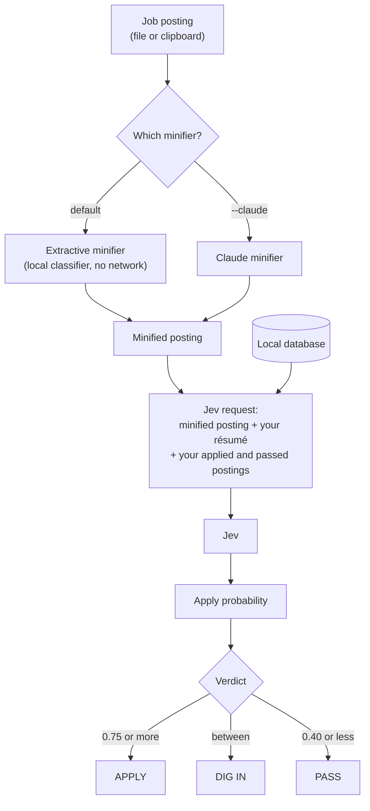
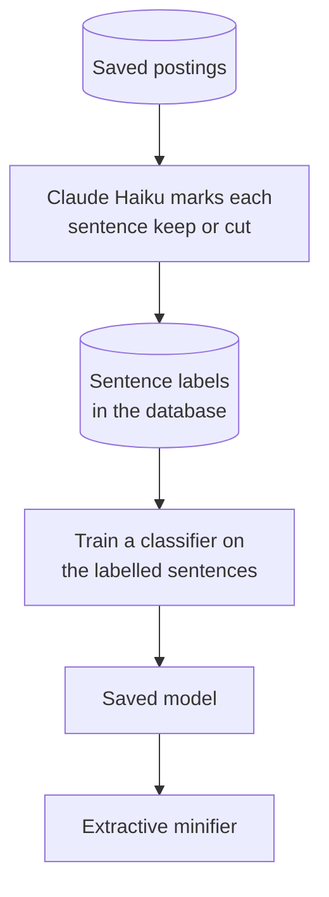

# assay

I created this tool as a utility to help me sift through piles of job descriptions quickly and get to the jobs that look like they fit me. The tool uses Anthropic's Claude LLM and Typesafe's Jev classifier. Currently you need a Claude subscription and an API key for Jev. It also requires you to build up a list of jobs that you found worth applying to and a set you found worth passing on.

With that setup, the tool allows you to copy a job description from your favorite website and run `assay`, and get back a result like the following:

```
Minifying (extractive)...
Minified (658 words, of 1272):

{a minified job description}

========================================
Recommendation: APPLY
Apply probability: 95%
Confidence: 0.90
Tokens used: 9820
```

## Install

Assay is installed as a pipx package, and requires Python 3.12 or newer.

```
pipx install jd-assay
```

You can also install it from this repo using:

```
pipx install . --editable
```

To hit Jev, you need a `TYPESAFE_API_KEY` defined in your environment. You'll also need the `claude` command-line tool on your PATH.

After this, you need to build your local database where your job decisions get stored.

```
assay init
```

You also need a text-based résumé you'll use for Jev to compare against the job description.

```
assay resume resume.txt
```

Finally you'll need a set of jobs you applied to or passed on, again, in text form.

```
assay apply jobs/applied/*.txt
assay pass jobs/passed/*.txt
```

Jev needs at least one applied and one passed posting to compare against, but the location of these files really can be anywhere. These get absorbed into the database after you run the command, so you can delete the text files after they're uploaded.

## The Extractive Minifier

Using Claude to minify job descriptions costs about ten seconds on my machine and you get nearly identical results by building a minifier from your example job descriptions. Once you have ten or so examples of both applied and passed descriptions, run the following:

```
assay rebuild
```

This will build a local statistical classifier by taking all the job descriptions in the database, running each sentence through Claude Haiku, and asking it to determine which ones can be cut. It stores those and later, minifies a JD by removing sentences that don't influence the evaluation. This is done without any external calls.

A job description can be minified via Claude and then evaluated by Jev (skipping the extractive minifier) by running the following:

```
assay --claude
```

## Where the data lives

The database and the trained model are in your operating system's per-user data directory
(`~/.local/share/assay` on Linux). Set `ASSAY_HOME` to use a different folder.

## Uninstall

Uninstalling the program does not delete your data. To remove everything:

```
assay export backup.jsonl   # optional: keep a copy of your postings
assay purge
pipx uninstall jd-assay
```

## Commands

| Command | What it does |
| --- | --- |
| `assay [file] [--claude]` | Check a posting from a file or the clipboard. Saves nothing. Prints APPLY (0.75 and above), PASS (0.40 and below) or DIG IN. |
| `assay init` | Create the database, or add any missing tables without touching data. |
| `assay resume [file]` | Save or replace your résumé; with no file, show the saved one. |
| `assay apply\|pass [file...]` | Record postings with a decision. |
| `assay list [id]` | List saved postings, or show one posting's minified text. |
| `assay update ID apply\|pass` | Change a saved posting's decision. |
| `assay remove ID` | Delete a saved posting. |
| `assay export [file]` | Write everything as JSON lines, to a file (which must not exist) or stdout. |
| `assay rebuild` | Label new postings and retrain the extractive minifier's classifier. |
| `assay purge` | Delete assay's data after asking. |

## Development

```
python -m venv .venv
.venv/bin/pip install -e ".[dev]"
.venv/bin/pytest
```

The tests never call Claude or Jev and never touch your real data.

### How it works

Checking a posting:



Training the extractive minifier (`assay rebuild`):



## License

MIT. See `LICENSE`.
